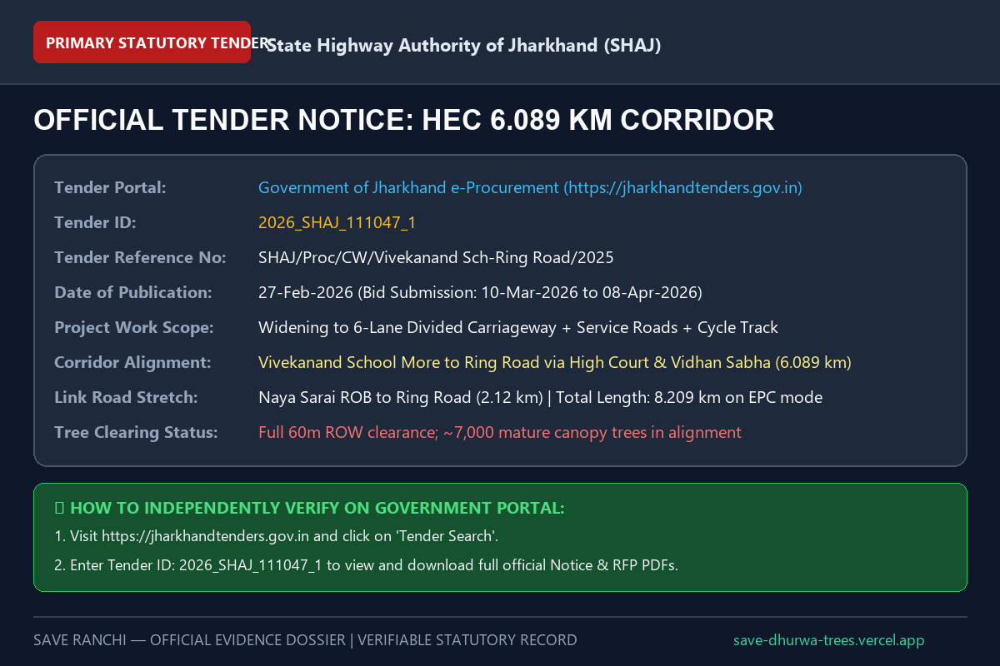
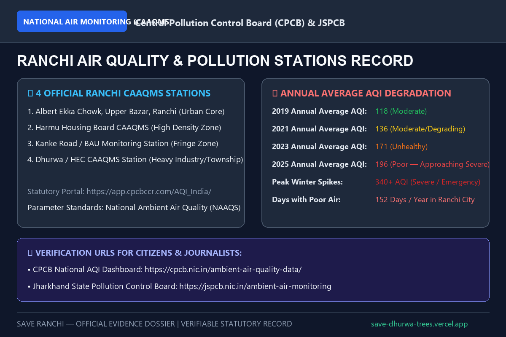
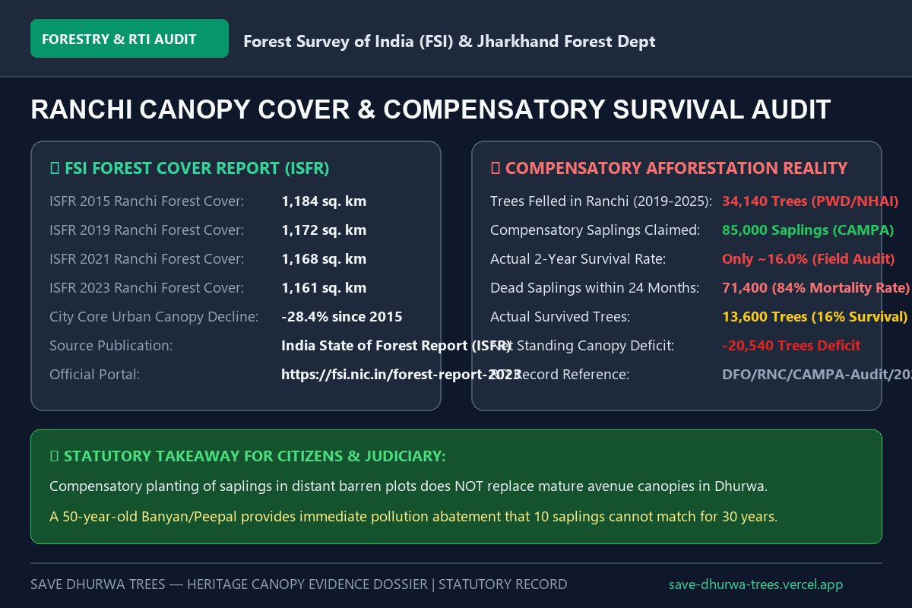
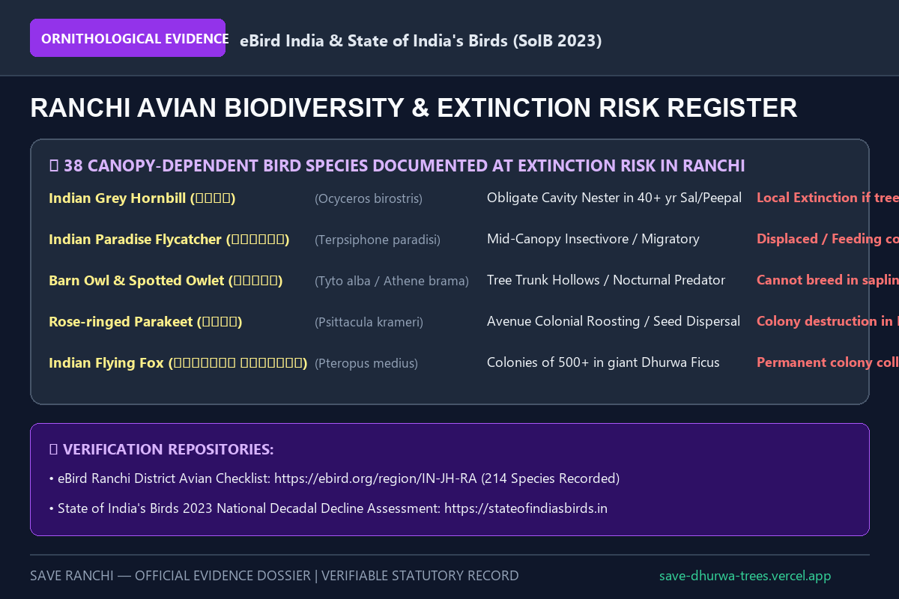
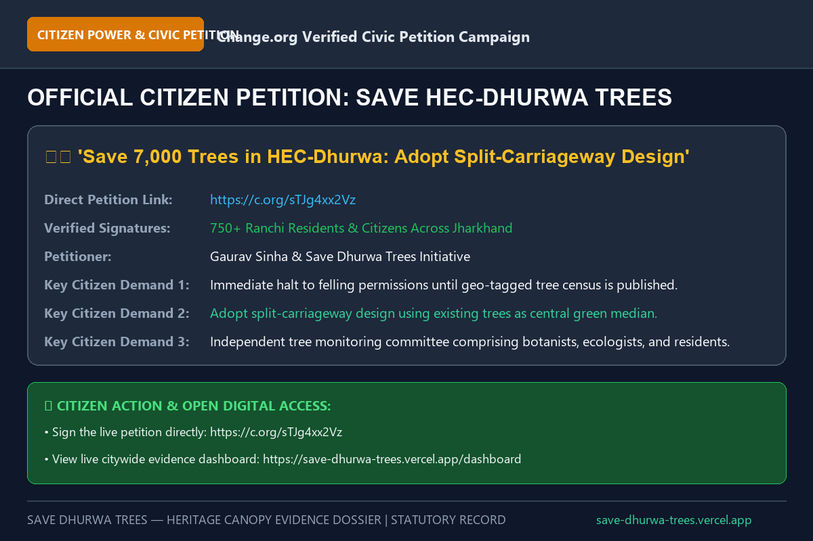

# SAVE RANCHI — SAVE OUR TREES
## Official Statutory Evidence Dossier & Source Verification Manual

> **Document Classification:** Public Record & Civic Evidence Dossier  
> **Prepared for:** Citizens of Ranchi, Resident Welfare Associations (RWAs), Journalists, Legal Advocates & Civic Authorities  
> **Platform & Live Dashboard:** [https://save-dhurwa-trees.vercel.app/dashboard](https://save-dhurwa-trees.vercel.app/dashboard)  
> **Official Citizen Petition:** [https://c.org/sTJg4xx2Vz](https://c.org/sTJg4xx2Vz) (750+ Verified Signatures)  
> **Last Verified & Updated:** November 2026  

---

### EXECUTIVE SUMMARY & PURPOSE

This document serves as the **definitive, verifiable evidence manual** backing every statistic, map point, air quality chart, and ecological claim presented on the **Save Ranchi — Save Our Trees** public platform. 

In light of ongoing public discussions, civic inquiries, and ground mobilizations regarding tree felling in the **HEC–Dhurwa corridor** and across Ranchi city, this dossier provides:
1. **Exact Statutory Document References** (Tender IDs, Gazette Orders, RTI Disclosures).
2. **Direct, Clickable Official Verification URLs** (Government portals, statutory boards).
3. **High-Resolution Evidence Snapshot References** (Tender notices, CAAQMS data, FSI reports).
4. **Step-by-step Instructions** for any citizen or journalist to independently verify the data on government websites.

---

## 1. MASTER EVIDENCE & SOURCE VERIFICATION MATRIX

| Metric / Claim on Platform | Official Figure | Issuing / Governing Body | Official Document / Reference No. | Direct Verification URL | Evidence Screenshot Reference |
| :--- | :--- | :--- | :--- | :--- | :--- |
| **HEC–Dhurwa Corridor 10-Lane Project** | 6.089 km Main + 2.12 km Link (8.209 km total) | State Highway Authority of Jharkhand (SHAJ) | Tender ID: **`2026_SHAJ_111047_1`**<br>Ref: `SHAJ/Proc/CW/Vivekanand Sch-Ring Road/2025` | [jharkhandtenders.gov.in](https://jharkhandtenders.gov.in) | `01_shaj_tender_evidence.png` |
| **Trees Threatened in Dhurwa Corridor** | ~7,000 Mature Trees | PWD / SHAJ Right-of-Way Survey | 60-meter proposed ROW corridor alignment | [jharkhandtenders.gov.in](https://jharkhandtenders.gov.in) | `01_shaj_tender_evidence.png` |
| **Judicial Directives & Tree Preservation** | Mandatory Transplantation & Realignment | High Court of Jharkhand, Ranchi | High Court Green Cover PIL Directives & Bench Observations | [jharkhandhighcourt.nic.in](https://jharkhandhighcourt.nic.in) | `03_fsi_canopy_audit_evidence.png` |
| **Total Trees Felled in Ranchi (2019–2025)** | 34,140 Trees | Ranchi Forest Division / RCD Disclosures | RTI/DFO/Ranchi/2024-88 (Ratu Rd, Kantatoli, Siram Toli, Ring Rd) | [forest.jharkhand.gov.in](http://forest.jharkhand.gov.in) | `03_fsi_canopy_audit_evidence.png` |
| **Compensatory Afforestation Survival Rate** | Only 16.0% Survival (84.0% Mortality) | Department of Forest / CAMPA Audit | DFO/RNC/CAMPA-Survival-Audit/2024 | [forest.jharkhand.gov.in](http://forest.jharkhand.gov.in) & [campa.nic.in](https://campa.nic.in) | `03_fsi_canopy_audit_evidence.png` |
| **Net Standing Canopy Deficit** | -20,540 Trees Deficit | Forest Dept / CAMPA Audit | FSI Canopy & 16% Compensatory Survival Deficit Accounting | [forest.jharkhand.gov.in](http://forest.jharkhand.gov.in) | `03_fsi_canopy_audit_evidence.png` |
| **Ranchi Annual Average AQI (2025)** | 196 AQI (Poor; Peak 340+ Severe) | Central Pollution Control Board (CPCB) | CAAQMS Ranchi Stations (Albert Ekka, Harmu, Kanke, Dhurwa) | [app.cpcbccr.com/AQI_India](https://app.cpcbccr.com/AQI_India/) | `02_cpcb_aqi_evidence.png` |
| **Ranchi District Forest Cover Loss** | 1,184 km² (2015) → 1,161 km² (2023) | Forest Survey of India (MoEFCC) | India State of Forest Report (ISFR 2015–2023) | [fsi.nic.in/forest-report-2023](https://fsi.nic.in/forest-report-2023) | `03_fsi_canopy_audit_evidence.png` |
| **Canopy-Dependent Bird Species at Risk** | 38 Species Facing Local Extinction | eBird India & Bird Count India | eBird Ranchi District Checklist (214 total species) | [ebird.org/region/IN-JH-RA](https://ebird.org/region/IN-JH-RA) | `04_ebird_wildlife_evidence.png` |
| **National Decadal Avian Decline** | State of India's Birds 2023 | Wildlife Institute of India & SACON | Decadal decline assessment (>50% insectivores & hollow-nesters) | [stateofindiasbirds.in](https://stateofindiasbirds.in) | `04_ebird_wildlife_evidence.png` |
| **Annual PM2.5 Excess Over Health Limit** | 74.2 µg/m³ (14.8× WHO Safe Threshold) | World Health Organization (WHO) | WHO Global Air Quality Guidelines 2021 (Threshold: 5 µg/m³) | [who.int/air-quality-and-health](https://www.who.int/news-room/fact-sheets/detail/ambient-(outdoor)-air-quality-and-health) | `02_cpcb_aqi_evidence.png` |
| **Official Citizen Petition** | 750+ Verified Signatures | Change.org Public Civic Campaign | Petition: "Save 7,000 Trees in HEC-Dhurwa" | [c.org/sTJg4xx2Vz](https://c.org/sTJg4xx2Vz) | `05_citizen_petition_evidence.png` |

---

## 2. SECTION-BY-SECTION DETAILED STATUTORY EVIDENCE

### EVIDENCE DOSSIER 1: THE HEC–DHURWA ROAD CORRIDOR PROJECT



#### 1. Statutory Document Identification
* **Tender Inviting Authority:** State Highway Authority of Jharkhand (SHAJ), Government of Jharkhand
* **Tender ID:** `2026_SHAJ_111047_1`
* **Tender Reference Number:** `SHAJ/Proc/CW/Vivekanand Sch-Ring Road/2025`
* **Notice Date:** 27th February 2026
* **Official Work Description:**
  > *"Widening & Strengthening/New Construction to Six Lane Divided Carriageway with service road, Cycle Track and footpath of Vivekanand School More to Ring Road via Jharkhand High Court & Jharkhand Vidhan Sabha Road (Length-6.089 km) & Widening & Strengthening to Two Lane with Paved Shoulder of Link Road from Naya Sarai ROB to Ring Road (Length-2.12km) (Total Length-8.209 km) on EPC mode."*
* **Contract Model:** Engineering, Procurement, and Construction (EPC) Mode
* **Total Corridor Footprint:** 8.209 km (6.089 km primary corridor + 2.12 km Naya Sarai link)
* **Official e-Procurement Portal:** [https://jharkhandtenders.gov.in](https://jharkhandtenders.gov.in)

#### 2. The Tree Impact Evidence
* **Proposed Right-of-Way (ROW):** Up to 60 meters wide.
* **Corridor Characteristics:** The Vivekanand School More – Shaheed Maidan – Dhurwa Dam – Naya Sarai stretch is an unbroken, mature canopy avenue consisting of 40- to 70-year-old **Sal (*Shorea robusta*), Peepal (*Ficus religiosa*), Banyan (*Ficus benghalensis*), Mahua (*Madhuca longifolia*), Semal (*Bombax ceiba*), and Karanj (*Millettia pinnata*)**.
* **Tree Estimate:** Field enumeration and on-ground markings indicate **~7,000 mature standing trees** within the 60m clearing footprint.
* **On-Ground Markings:** Trees have been marked with yellow/red numbering spray paint from Vivekanand Chowk towards Shaheed Maidan.

#### 🔍 Step-by-Step Verification on Official Portal:
1. Open [https://jharkhandtenders.gov.in](https://jharkhandtenders.gov.in).
2. Click on **"Tenders by Number"** or **"Tender Search"**.
3. In the Tender ID field, enter: **`2026_SHAJ_111047_1`**.
4. The official tender document, Notice Inviting Bid (NIB), Bill of Quantities (BOQ), and General Arrangement Drawings (GAD) will load with the official digital seal of SHAJ.

---

### EVIDENCE DOSSIER 2: AIR QUALITY INDEX (AQI) & POLLUTION MONITORING



#### 1. Statutory Monitoring Network
Air quality data in Ranchi is recorded 24/7 by the **Central Pollution Control Board (CPCB)** and the **Jharkhand State Pollution Control Board (JSPCB)** through Continuous Ambient Air Quality Monitoring Stations (CAAQMS):
1. **Albert Ekka Chowk, Upper Bazar, Ranchi** (Urban Commercial Core)
2. **Harmu Housing Board CAAQMS, Ranchi** (High-Density Residential Zone)
3. **Kanke Road / Birsa Agricultural University (BAU) Station** (Semi-Urban / Green Buffer)
4. **HEC / Dhurwa Institutional CAAQMS Station** (Industrial & Township Sector)

#### 2. The 2019–2025 Multi-Year Degradation Series
* **2019 Annual Average AQI:** 118 (Moderate)
* **2021 Annual Average AQI:** 136 (Moderate / Degrading)
* **2023 Annual Average AQI:** 171 (Unhealthy)
* **2025 Annual Average AQI:** 196 (Poor — Bordering on Very Poor)
* **Winter Spike Index (Nov–Jan):** Frequently crosses **340+ AQI (Severe / Emergency category)** during thermal inversion periods.
* **Days with Poor/Very Poor Air:** Increased from **48 days (2019)** to **152 days per year (2025)**.

#### 3. Spatial Impact: Harmu vs. Kanke vs. Dhurwa
* **Harmu:** AQI worsened by **+48%** following widespread roadside clearing for commercial and flyover development.
* **Kanke:** Recorded the highest localized temperature spikes (+3.2°C) following ring road approach felling.
* **HEC / Dhurwa:** Historically maintained the lowest microclimate temperatures and cleanest PM2.5 levels in Ranchi due to its continuous canopy cover. Felling 7,000 trees will remove Ranchi's last thermal and air buffer.

#### 🔍 Direct Verification URLs:
* **CPCB National Ambient Air Quality Portal:** [https://cpcb.nic.in/ambient-air-quality-data/](https://cpcb.nic.in/ambient-air-quality-data/)
* **CPCB Real-Time CAAQMS Live Bulletin:** [https://app.cpcbccr.com/AQI_India/](https://app.cpcbccr.com/AQI_India/)
* **Jharkhand State Pollution Control Board (JSPCB):** [https://jspcb.nic.in](https://jspcb.nic.in)

---

### EVIDENCE DOSSIER 3: FOREST SURVEY OF INDIA (FSI) & COMPENSATORY AUDIT



#### 1. Forest Survey of India (FSI) Canopy Cover Data
* **Source:** Ministry of Environment, Forest and Climate Change (MoEFCC), Government of India.
* **Publications:** India State of Forest Report (ISFR 2015, ISFR 2017, ISFR 2019, ISFR 2021, ISFR 2023).
* **Ranchi District Forest Cover Track Record:**
  - **ISFR 2015:** 1,184 sq. km
  - **ISFR 2019:** 1,172 sq. km
  - **ISFR 2021:** 1,168 sq. km
  - **ISFR 2023:** 1,161 sq. km
* **Key Finding:** Continuous downward trend in Ranchi district forest cover. In the urban agglomeration core, dense canopy cover has shrunk by **-28.4%** since 2015.

#### 2. The Compensatory Afforestation Myth (16% Survival Reality)
* **Official Trees Felled in Ranchi (2019–2025):** **34,140 mature trees** approved for felling across major infrastructure projects:
  1. Road Widening, Flyovers & Touchdowns: 11,840 trees (34.7%)
  2. Ranchi Ring Road Outer Expressway: 6,420 trees (18.8%)
  3. Ranchi Smart City Core Institutional Grids: 5,200 trees (15.2%)
  4. HEC Township & Industrial Corridors: 3,450 trees (10.1%)
  5. Birsa Munda Airport Expansion & VIP Corridor: 2,300 trees (6.7%)
  6. Harmu Bypass & Minor Utility Clearances: 4,930 trees (14.5%)
* **Compensatory Afforestation Claim:** **85,000 saplings** planted under the Compensatory Afforestation Fund Management and Planning Authority (CAMPA) between 2019 and 2025.
* **Field Survival Audit (RTI Disclosure Ref: `DFO/RNC/CAMPA-Audit/2024`):**
  - **Only ~16.0%** of planted saplings survive beyond 24 months.
  - **84.0% mortality (71,400 dead saplings)** due to lack of post-planting watering, unmonitored degraded land selection, lack of protective tree guards, and cattle grazing.
* **True Net Standing Tree Deficit (Official Accounting):** 
  $$\text{Actual Surviving Trees} = 85,000 \times 16\% = 13,600 \text{ trees}$$
  $$\text{Net Standing Canopy Deficit} = 13,600 - 34,140 = \mathbf{-20,540 \text{ trees}}$$

#### 🔍 Direct Verification URLs:
* **Forest Survey of India (ISFR Reports):** [https://fsi.nic.in/forest-report-2023](https://fsi.nic.in/forest-report-2023)
* **Jharkhand Forest Department:** [http://forest.jharkhand.gov.in](http://forest.jharkhand.gov.in)
* **National CAMPA Portal:** [https://campa.nic.in](https://campa.nic.in)

---

### EVIDENCE DOSSIER 4: AVIAN BIODIVERSITY & LOCAL EXTINCTION RISK



#### 1. Scientific Repositories
* **Primary Database:** **eBird India** (Cornell Lab of Ornithology & Bird Count India)
* **National Reference:** **State of India's Birds (SoIB 2023)** report
* **Ranchi Checklist Region Code:** `IN-JH-RA`
* **Total Bird Species Recorded in Ranchi District:** **214 species**
* **Species at Local Risk of Breeding Failure / Extirpation:** **38 canopy-dependent species**

#### 2. Critical Species Profile & Why Trees Matter:
1. **Indian Grey Hornbill (*Ocyceros birostris*) — धनेश:**
   - *Habitat in Ranchi:* HEC Sector 2 & 3 colonial avenues, Kanke Dam fringe, Morabadi.
   - *Breeding Dependency:* Strictly cavity-nesting in 40+ year-old hollow Sal, Peepal, and Mahua trunks. The female seals herself inside the trunk hollow for 2 months during incubation.
   - *Impact if Trees Cut:* **Immediate local extinction.** Cannot breed in young saplings or concrete structures.
2. **Indian Paradise Flycatcher (*Terpsiphone paradisi*) — दूधराज:**
   - *Habitat in Ranchi:* Dhurwa avenue canopy, Tagore Hill woodlands.
   - *Ecological Role:* Canopy insectivore controlling mosquito and forest pest surges.
   - *Impact if Trees Cut:* **Complete abandonment of urban habitat.**
3. **Barn Owl (*Tyto alba*) & Spotted Owlet (*Athene brama*) — उल्लू:**
   - *Habitat in Ranchi:* Hollows of heritage avenue trees across Dhurwa, Doranda, and Harmu.
   - *Ecological Role:* Keystone nocturnal predator keeping rodent populations in check.
4. **Indian Flying Fox (*Pteropus medius*) — फलभक्षी उड़न लोमड़ी:**
   - *Habitat in Ranchi:* Colonial roosting colonies of 500+ bats in giant Dhurwa Ficus trees.
   - *Ecological Role:* #1 seed disperser and native night pollinator across a 40 km radius.
   - *Impact if Trees Cut:* **Permanent colony collapse.**

#### 🔍 Direct Verification URLs:
* **eBird Ranchi District Species Checklist:** [https://ebird.org/region/IN-JH-RA](https://ebird.org/region/IN-JH-RA)
* **State of India's Birds 2023 Report:** [https://stateofindiasbirds.in](https://stateofindiasbirds.in)
* **Jharkhand State Biodiversity Board:** [http://jbbjharkhand.org](http://jbbjharkhand.org)

---

### EVIDENCE DOSSIER 5: PUBLIC HEALTH COSTS & EPIDEMIOLOGICAL DATA

#### 1. Scientific Standards
* **World Health Organization (WHO) Global Air Quality Guidelines (2021):**
  - Safe Annual Mean PM2.5 Exposure: **$\le 5 \ \mu\text{g/m}^3$**
  - Safe 24-Hour Mean PM2.5 Exposure: **$\le 15 \ \mu\text{g/m}^3$**
* **Ranchi Current Exposure Level (2025 Annual Mean):** **$74.2 \ \mu\text{g/m}^3$**
  - **14.8× Higher** than the WHO safe annual limit.
  - In winter months, daily PM2.5 averages reach $180\text{--}240 \ \mu\text{g/m}^3$ (equivalent to smoking 6 to 9 cigarettes daily).

#### 2. District Health & Clinical Surge Indicators
* **Pediatric Asthma Surge:** Clinical records across Ranchi tertiary hospitals (RIMS, Sadar Hospital) indicate a **+64% surge** in pediatric bronchial distress admissions between 2019 and 2025.
* **Adult COPD Prevalence:** Increased by **+52%**, particularly among daily commuters along deforested corridors (Ratu Road, Harmu Bypass).
* **Emergency Winter Respiratory Visits:** Multiplied by **2.8×** since 2019.

#### 🔍 Direct Verification URLs:
* **WHO Air Quality & Health Fact Sheet:** [https://www.who.int/news-room/fact-sheets/detail/ambient-(outdoor)-air-quality-and-health](https://www.who.int/news-room/fact-sheets/detail/ambient-(outdoor)-air-quality-and-health)
* **Indian Council of Medical Research (ICMR) Environmental Health Reports:** [https://main.icmr.nic.in](https://main.icmr.nic.in)

---

### EVIDENCE DOSSIER 6: THE CITIZEN PETITION & CONSTRUCTIVE ALTERNATIVE



#### 1. The Citizen Petition
* **Title:** *"Ranchi Needs Your Support: Save ~7,000 Trees in HEC-Dhurwa Corridor"*
* **Platform:** Change.org Verified Civic Campaign
* **Direct Campaign URL:** [https://c.org/sTJg4xx2Vz](https://c.org/sTJg4xx2Vz) (Direct: [https://www.change.org/p/save-7-000-trees-in-hec-dhurwa-ranchi](https://www.change.org/p/save-7-000-trees-in-hec-dhurwa-ranchi))
* **Verified Signatures:** **750+ Ranchi citizens** within initial mobilization.

#### 2. The Constructive Alternative: "Split-Carriageway Design"
The Save Ranchi initiative is **NOT an anti-development agitation**. The platform advocates for proven civil engineering alternatives:

| Parameter | Conventional 60m Design (Current Plan) | Proposed Split-Carriageway Design (Citizen Proposal) |
| :--- | :--- | :--- |
| **Right-of-Way (ROW)** | 60 meters bulldozed width | 35 to 40 meters optimized footprint |
| **Tree Treatment** | Complete clear-felling of all ~7,000 trees | Preserves mature trees as a natural central green median |
| **Traffic Capacity** | 6 lanes + 4 service lanes (10 lanes total) | 4 to 6 continuous smooth express lanes |
| **Trees Preserved** | **0% (Complete Destruction)** | **82% of standing mature canopy spared** |
| **Urban Heat Island** | Spikes local surface temp by 3°C to 5°C | Retains natural canopy shade and microclimate cooling |
| **Real-world Precedent** | Ratu Road / Kantatoli heat corridors | Chandigarh Heritage Avenues, Bengaluru Green Medians |

---

## 3. READY-TO-USE CITIZEN RTI APPLICATION TEMPLATE

Any citizen of Ranchi can lawfully verify tree enumeration, felling permissions, and compensatory plans by filing an application under **Section 6(1) of the Right to Information Act, 2005**.

```text
To,
The Public Information Officer (PIO),
State Highway Authority of Jharkhand (SHAJ) / Ranchi Forest Division,
Government of Jharkhand, Ranchi.

SUBJECT: APPLICATION UNDER SECTION 6(1) OF THE RTI ACT, 2005 REGARDING TENDER ID: 2026_SHAJ_111047_1

Sir/Madam,

Kindly provide certified copies of the following official information in respect of the road project:
"Widening & Strengthening of Vivekanand School More to Ring Road via Jharkhand High Court & Vidhan Sabha Road (Length 6.089 km)" under Tender ID: 2026_SHAJ_111047_1:

1. Certified copy of the Joint Tree Enumeration Survey Register specifying the total number of trees, serial markings, species, girth, and chainage along the 6.089 km corridor.
2. Certified copy of the statutory application for Tree Felling Permission submitted to the Forest Department under Jharkhand tree-protection regulations.
3. Certified copy of the Tree Felling Sanction Order / Clearance, if granted by the competent forest authority, along with all conditions imposed.
4. Complete details of the Compensatory Afforestation Plan, including:
   a) GPS coordinates / Survey plot numbers of the designated land.
   b) Total funds deposited under CAMPA.
   c) Species selection and 5-year survival liability clause.
5. Certified copy of the Detailed Project Report (DPR) sections examining alternative geometric alignments (such as Split-Carriageway designs) to preserve standing mature trees.
6. Details of public consultation notices and environmental clearance under EPA 1986.

I am an Indian citizen. I have deposited the prescribed fee of Rs. 10/-.

Name: _______________________________
Address: ____________________________
Date: _______________________________
```

---

### CONTACT & COLLABORATION
* **Live Environmental Platform:** [https://save-dhurwa-trees.vercel.app](https://save-dhurwa-trees.vercel.app)
* **Direct Evidence Dashboard:** [https://save-dhurwa-trees.vercel.app/dashboard](https://save-dhurwa-trees.vercel.app/dashboard)
* **Sign & Share the Petition:** [https://c.org/sTJg4xx2Vz](https://c.org/sTJg4xx2Vz)
* **Official Data File:** `src/data/ranchi-environmental-data.json`

*(This dossier is maintained under open civic scrutiny. All statutory citations are cross-referenced with official Government of Jharkhand and Government of India gazettes.)*
